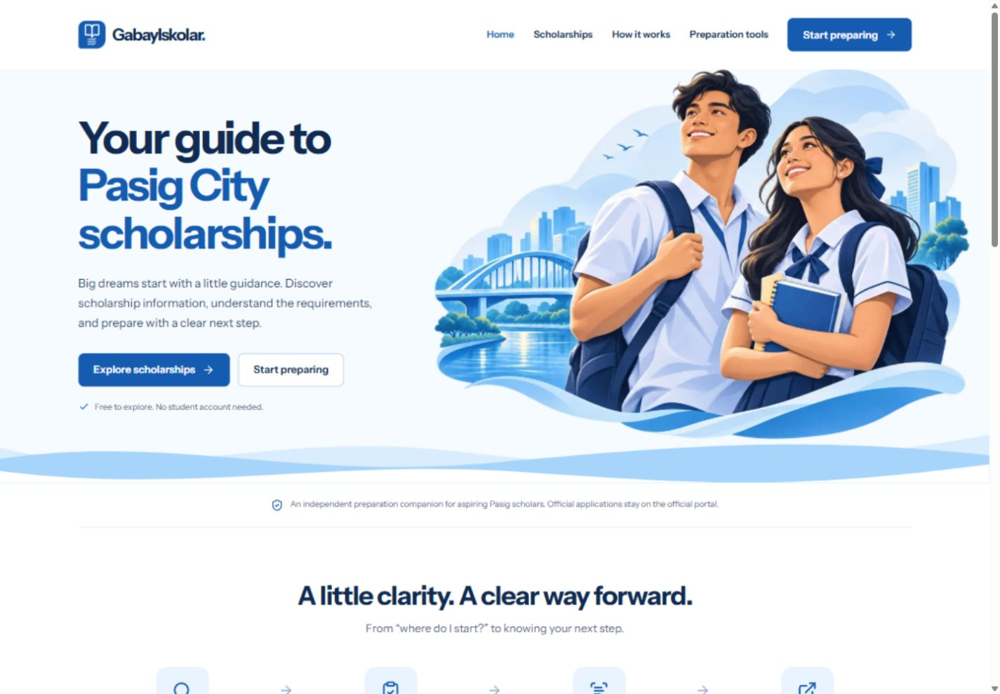
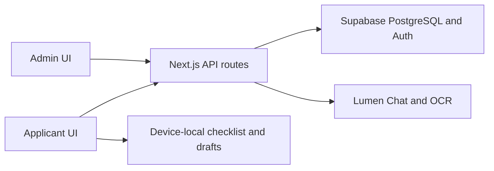

# GabayIskolar

**Clear scholarship guidance. Organized preparation.**

GabayIskolar helps Pasig students understand scholarship requirements, prepare
their documents, and track their next steps. Built by **The Prompters** for
**OVERCLOCK 2026**, it combines published scholarship guides, a personal checklist,
document review, and source-backed AI assistance in an account-free applicant workspace.

> **Independent prototype.** GabayIskolar is not affiliated with or endorsed by
> Pasig City Government or its scholarship office. It supports preparation; it
> does not submit applications, verify eligibility or document authenticity, or
> approve scholarships. Official applications and decisions remain with the
> responsible office.



[Features](#features) · [Quick start](#quick-start) · [Privacy](#privacy-and-security) · [Testing](#testing-and-verification) · [Documentation](#documentation)

## Why this project

Scholarship preparation involves more than finding an application link. Students
need to understand which documents to prepare, how to obtain them, what remains
unfinished, and where to find reliable guidance. GabayIskolar brings these tasks
into one preparation workspace while administrators maintain the supporting content.

## Features

### Applicant workspace

- **Published scholarship guides:** browse available cycles, requirements, acquisition steps, FAQs, source references, dates, and official application links.
- **Preparation checklist:** mark your own progress locally; changed instructions or sources can prompt another review.
- **Private application draft:** save optional preparation details on your device, restore them after refresh, export a JSON copy, or delete them.
- **Check a document:** send a fictional/sample document to Lumen OCR with consent, then review and correct extracted suggestions and warnings.
- **Ask Gabay:** ask questions against approved, published reference text, with source citations and clear unsupported/unavailable states.
- **Official handoff:** review remaining preparation and continue to the scholarship office's application destination.

Applicants do not need to sign up or log in. Checklist progress is self-reported
preparation, not an eligibility decision or official document verification.

### Administrator workspace

- Provisioned admin sign-in with server-verified cookie sessions and role checks.
- Program/cycle management and atomic saves for requirements, ordered steps, FAQs, and reference text.
- Explicit human source review and server-side publication readiness checks.
- Publisher-only publish/unpublish; draft and unapproved content stays inaccessible to public reads.
- Admin V3 charts based on saved content records, conditional pagination, guided authoring, and an applicant-content preview.
- Local Markdown/TXT field prefill with review before applying it to the editor.

**Current roles:** editors can read content; publishers can save, review, delete,
and publish. Admin charts describe content operations, not student submissions.

## How it works

**Applicant:** choose a guide → prepare requirements → optionally review a sample
document → ask source-backed questions → visit the official application portal.

**Admin:** sign in → create a guide/cycle → add requirements and reference text →
review sources → publish → verify the applicant view.



Public guide reads use anonymous database access under RLS, even when an admin
is signed in. Administrative writes verify both server authorization and database
permissions. The private draft form saves directly to the device, not through a
personal-data upload API.

## Technology

| Layer | Tools |
|---|---|
| Frontend | Next.js 15 App Router, React 19, TypeScript |
| Interface | Tailwind CSS, Radix Select, Lucide icons, Motion, dnd-kit |
| Backend | Next.js Route Handlers and Zod validation |
| Database and admin identity | Supabase PostgreSQL, Auth, RLS and transactional SQL functions |
| Knowledge retrieval | PostgreSQL full-text search over approved published text |
| AI services | Server-side Lumen Chat and OCR adapters |
| Browser persistence | localStorage for preferences/checklist; IndexedDB for private drafts |
| Testing and hosting | Vitest, Node test runner, Playwright, GitHub Actions; Vercel hosting |

There is no separate Python/FastAPI service. Lumen requests originate from the backend.

## Quick start

### 1. Install and configure

Requirements: **Node.js 22 or newer**, npm, and Git.

The integrated development features described here are available on `staging`:

```bash
git clone --branch staging https://github.com/Rikitu03/Hackathon-Da-Prompters-2026.git
cd Hackathon-Da-Prompters-2026
npm ci
npm run setup:env
```

`setup:env` creates `.env.local` from [.env.example](.env.example) without
overwriting an existing file. Edit `.env.local` before starting the app:

| Variable | Purpose | Visibility |
|---|---|---|
| `NEXT_PUBLIC_SUPABASE_URL` | Shared Supabase project URL; supplied in the template | Public |
| `NEXT_PUBLIC_SUPABASE_ANON_KEY` | Public publishable/anon key; supplied in the template | Public |
| `APPLICANT_SESSION_SECRET` | Shared signing key matching the provisioned private database key | Server only; obtain privately |
| `LUMEN_API_KEY`, `LUMEN_API_SECRET` | Credentials for enabled AI services | Server only |
| `LUMEN_CHAT_URL`, `LUMEN_OCR_URL` | Verified provider endpoints | Server only |
| `LUMEN_CHAT_INSTANCE_ID` | Chat instance configuration | Server only |
| `LUMEN_CHAT_ENABLED`, `LUMEN_OCR_ENABLED` | Set either to `false` to disable that AI feature | Server only |

All four teammates use the same `gabayiskolar-dev` project and the same private
applicant signing key. **Do not generate a different signing key for each teammate
or replace the existing database key.** Missing/mismatched reference configuration
returns 503; public guides and device-local draft saving remain available.

See [shared team setup](docs/TEAM_ENVIRONMENT.md) and
[applicant privacy configuration](docs/APPLICANT_PRIVACY.md). The running app does
not require a Supabase service-role key. Never put private keys in `NEXT_PUBLIC_*`
variables, screenshots, or committed files.

### 2. Start locally

```bash
npm run dev
```

Open **http://localhost:3000**. Start at `/onboarding`, select a guide, and click
**Create my workspace** to populate the applicant Dashboard. Without a selected
guide, workspace pages show their setup/empty state.

Restart the development server after changing environment values. After pulling
dependency updates, run `npm ci` again.

### 3. Choose a workspace

| Route | Purpose |
|---|---|
| `/` | Applicant homepage |
| `/onboarding` | Choose preparation preferences and a guide |
| `/dashboard` | Selected guide and next preparation steps |
| `/scholarships` | Published guide catalogue |
| `/my-checklist` | Device-local preparation progress |
| `/application-draft` | Private draft save, restore, export and delete |
| `/document-review` | Consented sample-document OCR and editable review |
| `/assistant` | Source-backed questions |
| `/summary` | Preparation summary and official application handoff |
| `/admin` | Authenticated admin workspace |
| `/admin/demo` | Interactive fictional admin preview; changes are not saved |
| `/backend-lab` | Developer workbench for real backend/API operations |
| `/api/health` | Database readiness and configuration indicators |

## Shared database and development data

The shared development database already has the repository's four migrations
applied. **Teammates should not reset it or manually rerun applied migrations.**
For a new empty database, apply migrations in filename order using migration
tooling, then privately provision the applicant signing key and admin identities.

The database stores programs, cycles, requirements, steps, FAQs, knowledge sources,
text chunks and admin profiles. Separate private tables hold only browser-reference
security metadata and its server configuration.

Synthetic development fixtures include one published DEMO guide and one private
draft. They are not official scholarship offerings. A test publisher exists at
`dev-admin@gabayiskolar.test`; obtain its password privately. On the maintainer's
configured computer, it is `SEED_ADMIN_PASSWORD` in ignored `.env.seed.local`.
That file is not distributed by Git. Prefer individual accounts for regular admin work.

With the required private seed environment and the local backend running:

```bash
npm run check:db
npm run seed:dev
```

The seed creates missing synthetic examples without overwriting matching guides;
it is not a general database reset or damaged-content recovery tool. Never run
development account seeding against production. See the
[backend walkthrough](docs/BACKEND_WALKTHROUGH.md) for account and seed instructions.

## Privacy and security

| Information | Storage |
|---|---|
| Scholarship content and administrator roles | Supabase, protected by role checks and RLS |
| Selected guide and checklist progress | This browser's localStorage |
| Personal preparation draft | This browser profile's IndexedDB |
| Random browser-reference ID, token hash, timestamps and optional daily IP hash | Private Supabase metadata; seven-day reference expiry and hourly cleanup |
| Selected OCR input or chat question | Sent to Lumen only when that feature is used |

**Local drafts:** no applicant account, no cloud draft synchronization, and no
personal draft fields sent to the session API. Device storage is not encrypted by
this app; another person using the same browser profile may access it. Clearing
site data can lose drafts, and exported files should be kept private.

**AI tools:** the local-only guarantee applies to the private draft form. Lumen
retains OCR documents and chat transcripts; provider documentation records
organization visibility for OCR documents and no OCR delete API. Use fictional
or sample documents for demonstrations, review OCR results, and avoid personal
details in chat. See [provider retention and verification](docs/LUMEN_CONTRACT.md).

**Admin security:** no public admin signup, no client-side role assignment, and
no private credentials in browser bundles. Administrator operations require
server checks and database permissions.

## Testing and verification

```bash
npm run typecheck
npm run lint
npm test
npm run test:applicant
npm run build
```

With the local server running, `npm run check:backend` performs read/validation/auth
HTTP smoke checks. `npm run check:db` checks public database visibility using
the configured public key.

For browser tests, install Chromium and let Playwright start its test server.
Stop any normal app process occupying port 3000 first so the suite uses its
reserved mock configuration:

```bash
npx playwright install chromium
npm run test:e2e
```

Browser tests mock external services; they do not establish live Lumen success.
The three SQL suites in [supabase/tests](supabase/tests) cover real role permissions,
guide publication, atomic edits and guest metadata isolation with rollback fixtures.
Run them only through trusted database tooling in the intended test environment.

Recorded checks on **13 November 2026**: 134 unit tests, 24 applicant model/adapter
tests, and 78 desktop/mobile browser cases passed, with two intentional viewport
skips. Typecheck, lint and production build passed. Live synthetic admin and local
draft checks are described in [current status](docs/STATUS.md); these are dated
results, not a guarantee for every later commit or deployment.

## Deployment and current limits

Vercel is the hosting target. Configure public build-time values and private
server values in the hosting environment; `.env.local` does not configure a
deployment. Redeploy after environment changes. Follow [deployment instructions](docs/DEPLOYMENT.md)
and verify the chosen URL/commit, database readiness, admin saves/publication,
applicant references and intended AI flow.

The documented staging deployment has a successful Vercel status, but full deployed
acceptance and rollback/release evidence remain separate checks. There is no final
verified release URL claimed here.

Known boundaries:

- Shared DEMO records are synthetic; real scholarship guidance needs human source verification and publication.
- Education-level, new/renewal and semester metadata are not yet implemented in the guide contract; onboarding preferences do not establish eligibility.
- Retrieval is cycle-scoped; strict requirement associations and a complete source-version handoff remain coordination work.
- Lumen adapters and recorded provider probes exist, but a successful cited answer through the full published-content applicant flow still needs reviewed content and acceptance evidence.
- The admin PDF/DOC/DOCX importer does not perform AI extraction; its implemented prefill is local Markdown/TXT parsing. This differs from applicant Lumen OCR.
- Rate limits are best-effort and per server instance. Historical published revisions and cross-device draft synchronization are not implemented.

## Repository layout

```text
src/
  app/(applicant)/       Applicant pages
  app/admin/            Admin routes
  app/api/              Public, admin, auth, applicant-reference and AI endpoints
  components/           Applicant, admin and shared interface components
  lib/supabase/         Database clients and session integration
  lib/guides/           Guide schemas, data access and publication checks
  lib/applicant/        Applicant models, API adapters and local drafts
  lib/lumen/            Server-side provider adapters
  lib/rag/              Retrieval, prompt construction and citations
supabase/
  migrations/           Versioned database changes
  tests/                Rollback SQL permission/workflow checks
tests/                  Browser acceptance and applicant regression tests
scripts/                Setup, seed and verification utilities
docs/                   Architecture, contracts, evidence, handoffs and sprints
```

## Team and contribution workflow

| Member | Main responsibility | Feature branch |
|---|---|---|
| 1 | Applicant interface and preparation journey | `feat/applicant-ui` |
| 2 | Admin interface and reviewed scholarship content | `feat/admin-portal` |
| 3 | Database, backend APIs, security and integration/deployment support | `feat/backend-db` |
| 4 | Lumen OCR, Chat, retrieval and provider verification | `feat/lumen-rag` |

Coordinate shared schema/content changes, run relevant checks, and open a PR into
`staging` for review. Merge only after explicit team approval. Do not force-push
shared branches or reset the shared database during routine setup.

## Documentation

| Reference | Read it for |
|---|---|
| [Documentation index](docs/README.md) | All project references |
| [Current status](docs/STATUS.md) | Implemented behavior, dated evidence and remaining gaps |
| [Architecture](docs/ARCHITECTURE.md) | System flow and ownership |
| [API contracts](docs/API_CONTRACTS.md) | Request/response shapes and authorization |
| [Shared environment](docs/TEAM_ENVIRONMENT.md) | Teammate setup and database coordination |
| [Backend walkthrough](docs/BACKEND_WALKTHROUGH.md) | Admin accounts, seeds and manual tests |
| [Applicant privacy](docs/APPLICANT_PRIVACY.md) | Local drafts, browser metadata and signing-key setup |
| [Applicant handoff](docs/APPLICANT-HANDOFF.md) | Frontend journey and persistence |
| [Admin V3 handoff](docs/ADMIN_V3_QA_HANDOFF.md) | Admin design, charts, pagination and acceptance |
| [Lumen contract](docs/LUMEN_CONTRACT.md) | Provider behavior, retention and live-check evidence |
| [PSCS research](docs/scholarships/pscs/README.md) | Source research, fictional samples and extraction references |
| [Deployment](docs/DEPLOYMENT.md) | Hosting configuration and verification |
| [Sprint guides](docs/sprints/README.md) | Member responsibilities and delivery tasks |

Older plans and handoffs describe their recorded checkpoint. Use current code,
API contracts and the status/evidence documents to resolve later differences.

## Credits

Built by **The Prompters** for **OVERCLOCK 2026**. Instrument Sans is bundled under
its [OFL license](public/fonts/OFL.txt). The homepage illustration's generation
record is in [public/illustrations](public/illustrations).

For official applications, use the destination published by the scholarship
office, including the [Pasig City Scholarship Portal](https://scholars.pasigcity.gov.ph/).
