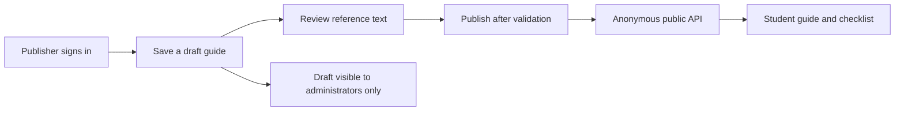

# Backend walkthrough and testing guide

Open **http://localhost:3000/backend-lab** while `npm run dev` is running. This is
a temporary integration workbench for the team. Its upper flow diagram is an
interactive explanation; its sign-in, save, publish, unpublish, delete, and public
result panels call the real backend and shared development database. `/admin`
currently redirects here. The final admin frontend can use the same APIs.

## What the backend is for

GabayIskolar helps students prepare scholarship requirements. Administrators
maintain source-backed guides. Applicants read those guides, follow acquisition
steps, and track a preparation checklist. They apply through the official office.

The original product flow is in [ARCHITECTURE.md](ARCHITECTURE.md), with endpoint
contracts in [API_CONTRACTS.md](API_CONTRACTS.md). The shared project and roles are
documented in [TEAM_ENVIRONMENT.md](TEAM_ENVIRONMENT.md).



## Implemented behavior

- Email/password sign-in, verified server identity, administrator role checks,
  cookie sessions, session refresh, and sign-out. No public admin signup.
- Anonymous scholarship list/detail and requirement detail endpoints. Public
  reads ignore administrator cookies, so previewing public output cannot reveal drafts.
- Atomic guide saves covering programs, cycles, requirements, steps, FAQs,
  sources, and searchable text chunks. A failure rolls back the whole save.
- Saving returns the program and edited cycle to draft. This hides the program's
  other cycles too until the program is published again; it is not a separate
  revision system that keeps an older version live.
- Publisher-only publishing and unpublishing. Publication checks description,
  dates, HTTPS official URL, at least one requirement, acquisition steps, and a
  reviewed approved source with reference text. A human must check whether the
  reference actually supports the guide; a URL is not automatic fact verification.
- Ordered text chunks and source version increments on subsequent saves.
  Source IDs and requirement IDs from a loaded document are preserved. Historical
  source content revisions are not retained.
- Program draft creation/editing and explicit program deletion with cascading
  descendants. Publisher permissions and RLS apply to every operation.
- Real database readiness checks and useful validation/authorization errors.

Lumen chat and OCR remain unimplemented. Their endpoints return 501/503 until
Member 4 connects verified services and the grounded retrieval pipeline. The
presence of knowledge chunks does not mean that the chatbot is connected.

## Seeded development account and content

The requested development seed has been applied to the shared project:

- Publisher email: `dev-admin@gabayiskolar.test`.
- Generated password: `SEED_ADMIN_PASSWORD` in the ignored `.env.seed.local` file
  on this computer. It is not in the app, tracked files, or `.env.example`.
- `DEMO — Published test scholarship`: publicly visible with an approved synthetic source.
- `DEMO — Private draft scholarship`: visible only to administrators, with an
  unapproved synthetic source so the publication validation can be tested.

Each guide has three requirements, six steps, three FAQs, one reference source,
and stored searchable text. The example documents, dates, and links are fictional.
The database rows persist after tests; reload the page to see them.

Open `/backend-lab`, sign in with the seed credentials, and select a saved guide.
Open `/scholarships` to see the published example without signing in. These are
development test credentials, not a replacement for individual teammate accounts.

With the local backend running, rerun the content seed with:

```powershell
npm run seed:dev
```

The script signs in through the real application API, verifies the cookie
session, creates missing demo guides, and checks committed data through new
requests. On the first run it also exercises the source review gate,
publish/unpublish/republish, public requirement reads, and sign-out. Existing
matching examples are retained without overwriting edits or duplicating them.

`supabase/seed-admin.sql` is the separate privileged account bootstrap used by
the Supabase integration. It requires transaction-local email/password/project
settings, is not a schema migration, and refuses to modify an unrelated account
or reset an existing seed password. Do not put real credentials in that file or
run development account seeding against a production database. For normal
accounts use the dashboard or trusted Auth admin tooling as described below.

## Individual accounts: project owner setup

1. Open the shared project's **Authentication → Users** section. Create an
   email/password Auth user through the dashboard, with a confirmed email for
   this development account. Choose the password privately.
2. Copy that user's UUID. In the SQL editor, replace the placeholder and run:

   ```sql
   insert into public.admin_profiles (user_id, role)
   values ('REPLACE_WITH_YOUR_AUTH_USER_UUID', 'publisher');
   ```

3. Sign in on `/backend-lab` using that application account. Your Supabase
   dashboard login is a separate identity. Each administrator should have an
   individual account. An `editor` profile has read-only access in the current MVP.

The app uses the shared public key with the caller's session and needs no
service-role key. Only the explicitly requested development seed account was
created automatically.

## Browser acceptance test

1. Read the three clickable flow stages. They explain visibility without
   changing data. Check that the database badge reports connected.
2. Sign in as a publisher. Keep the prefilled synthetic DEMO example for this
   test; it makes no claims about real scholarship dates or requirements.
3. Click **Save draft**. Expect a successful API response with `programId` and
   `cycleId`. It should appear in the saved guide selector but not Public result.
4. Click **Publish guide** before approving its source. Expect a validation error;
   the guide must remain hidden publicly.
5. Check the source review box, then **Save draft** again. In real content, check
   the reference before approving it. Editing source text clears its checkbox.
6. Click **Publish guide**. Expect success and a card in Public result.
7. Open that card in an incognito/private window. Expect the title, dates,
   requirement steps, FAQs, and reference link. No login should be required.
8. Check one preparation item, then reload. Expect progress to remain in that
   browser. It should not appear on a different device/browser.
9. Click **Unpublish** in the workbench, then reload the public page. The guide
   should disappear; a previously opened detail URL should show a not-found message.
10. After testing, use **Delete this program and its content** to remove the
    synthetic example. This deletes only the selected program but all of its cycles.

Use the **Last API result** panel to inspect failures and successful responses.
Use browser Developer Tools → Network to see request payloads and response codes.
Publish is disabled while there are unsaved form changes.

## Automated checks

With the development server running:

```powershell
npm run check:db
npm run check:backend
npm run typecheck
npm run lint
```

`check:backend` runs 17 real HTTP checks covering pages, database readiness,
public reads, invalid input, missing authentication, and cross-site writes. It
does not create users or content. `seed:dev` additionally verified a real password
sign-in, authenticated saves and reads, publication, and sign-out with the seeded
account. Set `BACKEND_TEST_URL` if using another localhost port.

Run these SQL files as `postgres` in the project's SQL editor or integration:

- `supabase/tests/permissions.sql`: actual row access and CRUD attempts under
  anonymous, ordinary authenticated, editor, and publisher roles.
- `supabase/tests/guide_workflow.sql`: draft saving, source reconstruction,
  review gate, role enforcement, publishing/unpublishing, and failed-save rollback.

Both suites create synthetic database identities and roll back everything. They
verify authorization through caller claims and database roles; the manual browser
test with a real Auth user verifies the full password-and-cookie path.

## Why there is no applicant table yet

The agreed MVP does not store student identities or scholarship applications.
Students can read guides without signing in. Checklist progress lives in
`localStorage`; OCR uploads are intended to be transient. Therefore there is no
applicant table in this implementation.

If the product later needs student sign-in and cross-device progress, use
Supabase Auth for identity, an optional `applicant_profiles` table for necessary
profile attributes, and `checklist_progress` rows owned by `auth.users.id` with
per-user RLS. Storing applications, uploaded documents, or eligibility data would
be a separate product scope and database design decision.
